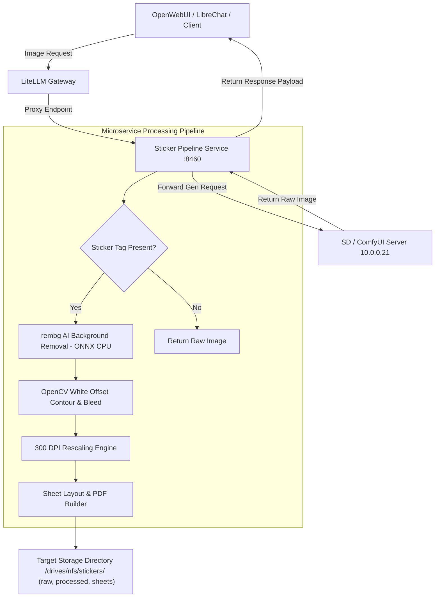
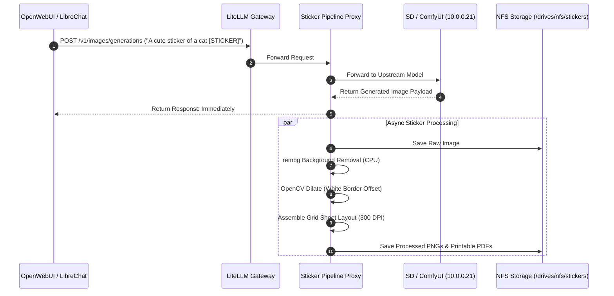

# StickerPipeline 🏷️✂️

[](https://github.com/spelech/StickerPipeline/actions/workflows/ci.yml)
[](https://github.com/spelech/StickerPipeline/actions/workflows/release.yml)
[](https://semver.org/)

An automated Python microservice that transforms AI-generated images (via **LiteLLM**, **OpenWebUI**, **LibreChat**, or **ComfyUI**) into high-precision, print-and-cut ready sticker sheets optimized for **Cricut Joy 2** cutting machines and **Epson EcoTank** network printers.

---

## 🌟 Key Features

- **Automated Ingress Interception**: Acts as an OpenAI-compatible API proxy layer. Intercepts image generations containing prompt tags like `[STICKER]` or routed via sticker agents.
- **CPU-Optimized AI Background Removal**: Powered by `rembg` (U-2-Net / ONNX Runtime CPU) for lightning-fast 1–2 second foreground segmentation without requiring host GPUs.
- **Die-Cut White Contour Generator**: Uses OpenCV kernel dilation and Gaussian smoothing to synthesize clean, smooth white sticker borders and optional color bleed margins.
- **High-DPI Sheet Builder**: Assembles processed sticker batches onto 300 DPI page layouts (US Letter / A4 / Cricut Joy 2 printable bounds) outputting printable PDF and PNG sheets.
- **Flexible REST API**: Upload raw images directly or trigger on-demand page assembly via REST endpoints.
- **Production Container Stack**: Microservice packaged as a Docker container integrated with system networks (`net_webservices`, `net_mcp`), persistent storage, and Caddy reverse proxy routing.

---

## 🏗️ Architecture & Data Flow



### Sequence Diagram



---

## ⚙️ Configuration & Environment Variables

| Variable | Default Value | Description |
| :--- | :--- | :--- |
| `STICKER_STORAGE_DIR` | `/drives/nfs/stickers` | Directory mounted for saving raw, processed, and sheet files. |
| `UPSTREAM_LLM_URL` | `http://litellm:4000/v1` | Upstream LiteLLM / OpenAI API endpoint URL. |
| `BORDER_OFFSET_PX` | `20` | Radius (in pixels) for the die-cut white offset outline. |
| `TARGET_DPI` | `300` | Target resolution for high-quality printing. |
| `PORT` | `8460` | Service listening port. |
| `AUTO_SHEET_BUILD_THRESHOLD` | `6` | Number of processed stickers required to trigger auto-sheet generation. |

---

## 🚀 Quickstart & Docker Setup

### 1. Standalone Docker Run
```bash
docker build -t sticker-pipeline:latest .

docker run -d \
  --name sticker-pipeline \
  -p 8460:8460 \
  -v /drives/nfs/stickers:/app/storage \
  -e UPSTREAM_LLM_URL="http://10.0.0.10:8448/v1" \
  sticker-pipeline:latest
```

### 2. Docker Compose Stack
```yaml
version: '3.8'

services:
  sticker-pipeline:
    build: .
    container_name: sticker-pipeline
    ports:
      - "8460:8460"
    environment:
      - STICKER_STORAGE_DIR=/app/storage
      - UPSTREAM_LLM_URL=http://litellm:4000/v1
      - BORDER_OFFSET_PX=20
      - TARGET_DPI=300
    volumes:
      - /drives/nfs/stickers:/app/storage
    restart: unless-stopped
    networks:
      - net_webservices
      - net_mcp

networks:
  net_webservices:
    external: true
  net_mcp:
    external: true
```

---

## 📑 Cricut Joy 2 Print-Then-Cut Workflow

1. **Generate Image**: Ask your OpenWebUI or LibreChat agent to generate an image. Include `[STICKER]` in the prompt or use the sticker agent.
2. **Auto-Processing**: The microservice extracts the subject, strips the background, applies the smooth white contour border, and saves:
   - `processed/<filename>_bordered.png` (Transparent PNG with white border)
   - `sheets/sheet_<timestamp>.pdf` (Printable 300 DPI sheet)
3. **Print on EcoTank**: Open `sheets/sheet_<timestamp>.pdf` or individual transparent PNG in Cricut Design Space and send to your network Epson EcoTank printer on sticker paper.
4. **Cut on Cricut Joy 2**: Load the printed sheet onto your Cricut Joy 2 mat, place it into the Cricut Joy 2 machine, and run the Print-Then-Cut / Die-Cut profile.

---

## 📡 REST API Reference

### Healthcheck
```http
GET /health
```
Response:
```json
{ "status": "ok", "service": "sticker-pipeline", "version": "1.0.0" }
```

### Direct Manual Image Upload Processing
```http
POST /api/v1/process
Content-Type: multipart/form-data

file: [Binary Image File]
border_px: 20
```

### List Processed Items
```http
GET /api/v1/stickers
```

### Generate Printable Sheet
```http
POST /api/v1/sheets/build
Content-Type: application/json

{
  "sticker_ids": ["img_001", "img_002"],
  "paper_size": "LETTER"
}
```

---

## 🧪 Testing & CI/CD

Run test suite locally:
```bash
pytest tests/ -v
```

This repository uses **GitHub Actions** for:
- Code linting and automated unit test execution (`.github/workflows/ci.yml`).
- Automated Semantic Versioning release creation and tagging on release (`.github/workflows/release.yml`).

---

## 📜 License

MIT License. Designed for home server automation.
